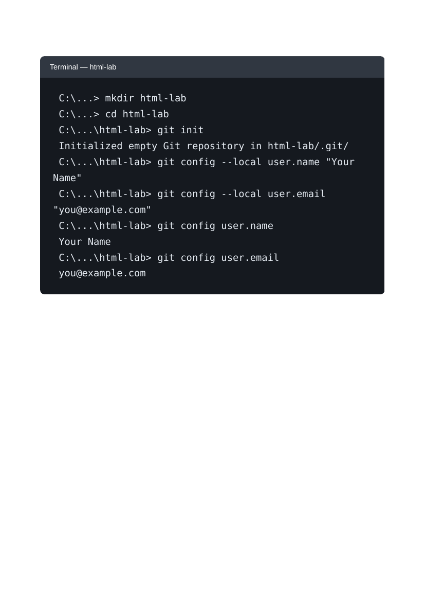
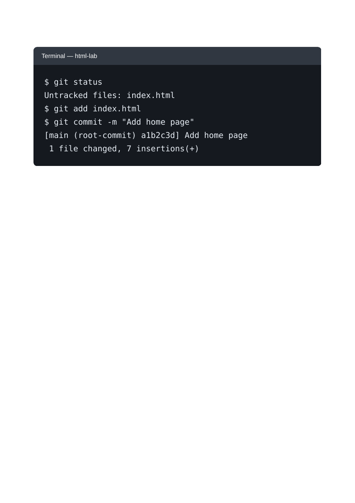
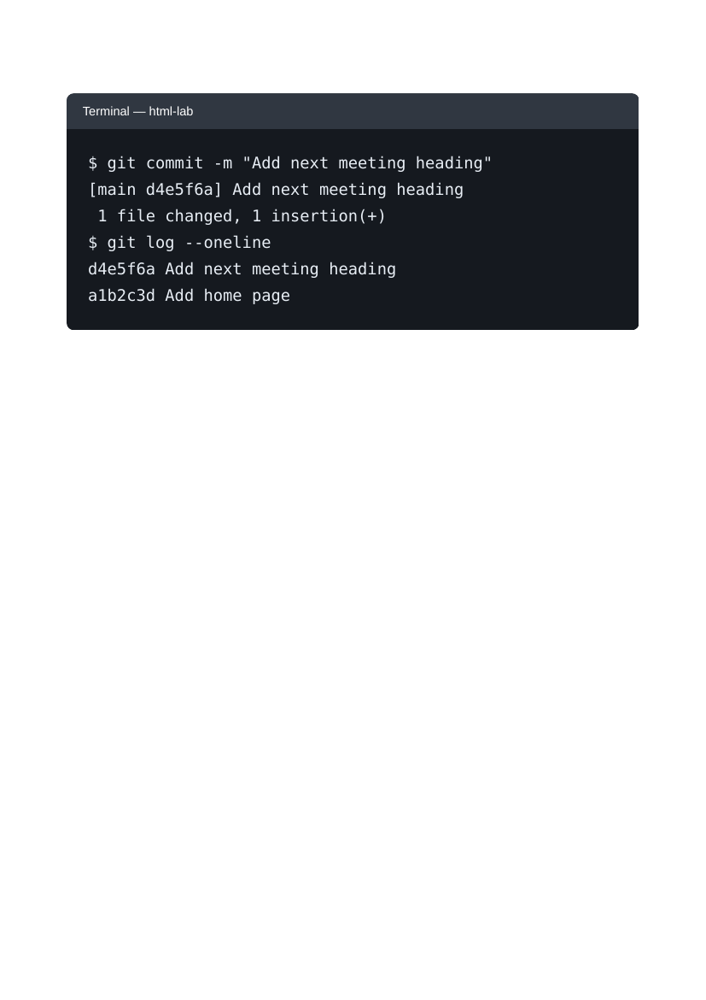

# Lab 1: Starting a Git Repository

## 📌 Objective
Introduction to Git version control: initializing a repository, setting local user configuration, staging changes, creating commits, and reviewing history.

---

## 📝 Lab Questions &amp; Solutions

### Question 1
**Problem Statement:**  
Create a folder named html-lab and start a Git repository in it with git init. Set your own name and email for this repository only (git config --local). Then show them with git config user.name and git config user.email.

**Code / Commands:**  
```bash
mkdir html-lab
cd html-lab
git init
git config --local user.name "Usman Khan"
git config --local user.email "usmankhanghazi189@gmail.com"
git config user.name
git config user.email
```

**Explanation:**  
git init initializes a new Git repository. The --local flag restricts user name and email configuration specifically to this repository without affecting global settings.

**Output Preview:**  


---
### Question 2
**Problem Statement:**  
Create index.html inside html-lab with one h1 heading, any text. Run git status, add the file and commit it with the message 'Add home page'.

**Code / Commands:**  
```html
<!DOCTYPE html>
<html lang="en">
<head>
    <meta charset="UTF-8">
    <title>Home</title>
</head>
<body>
    <h1>Welcome to my HTML Lab</h1>
</body>
</html>
```

**Explanation:**  
Save the markup as index.html. git status displays the working tree status; git add index.html stages the file; git commit -m records the snapshot.

**Output Preview:**  


---
### Question 3
**Problem Statement:**  
Add a second heading, an h2, below the first one in index.html. Commit it with the message 'Add next meeting heading', then run git log --oneline.

**Code / Commands:**  
```html
<!DOCTYPE html>
<html lang="en">
<head>
    <meta charset="UTF-8">
    <title>Home - HTML Lab</title>
    <link rel="stylesheet" href="style.css">
</head>
<body>
    <h1>Welcome to my HTML Lab</h1>
    <h2>Next Meeting</h2>
</body>
</html>
```

**Explanation:**  
Adding the h2 element creates a secondary subsection heading. Committing the updated file and checking git log --oneline shows the commit history with latest commits first.

**Output Preview:**  


---

## 🚀 How to Run
1. Open `index.html` in any modern web browser.
2. View specific exercises by opening their individual `.html` files in this directory.

---
*HTML &amp; CSS Development Lab (BCS554) • Invertis University Bareilly*  
*Student: Usman Khan (BCS2024054)*
