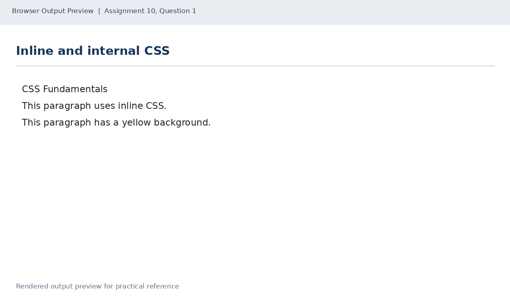
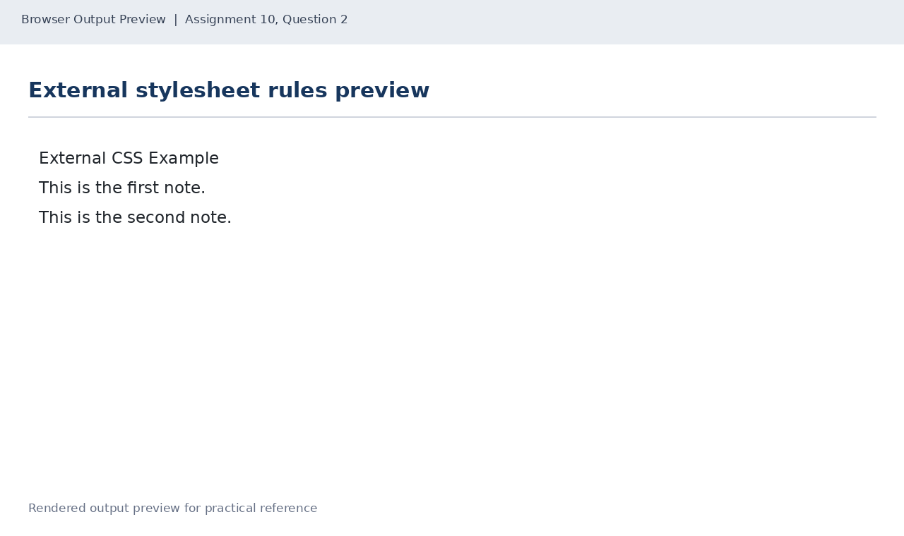
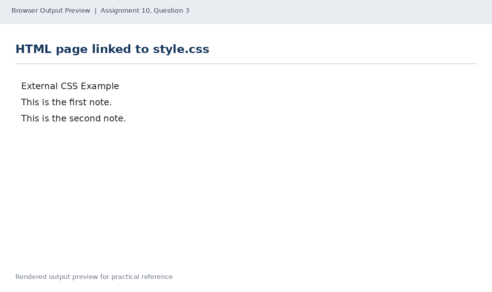

# Lab 10: CSS Fundamentals

## 📌 Objective
Understanding CSS inclusion methods (inline, internal style blocks, external stylesheets) and key CSS selectors (element, class, ID).

---

## 📝 Lab Questions &amp; Solutions

### Question 1
**Problem Statement:**  
Create inline-internal.html. In the head, add an internal style block that makes h1 navy and gives the class highlight a yellow background. In the body, add an h1 heading, a paragraph with an inline style that makes its text red, and a paragraph with the class highlight.

**Code / Commands:**  
```html
<!DOCTYPE html>
<html lang="en">
<head>
    <meta charset="UTF-8">
    <title>CSS Methods</title>
    <style>
        h1 { color: navy; }
        .highlight { background-color: yellow; }
    </style>
</head>
<body>
    <h1>CSS Fundamentals</h1>
    <p style="color: red;">This paragraph uses inline CSS.</p>
    <p class="highlight">This paragraph has a yellow background.</p>
</body>
</html>
```

**Explanation:**  
Internal styles reside inside style tags in head; inline styles use the style attribute on HTML elements; .highlight is a class selector.

**Output Preview:**  


---
### Question 2
**Problem Statement:**  
Create style.css with rules for: all h1 elements (navy), the class note (italic), the id title (underlined), and all p elements (font size 18px and a grey colour).

**Code / Commands:**  
```css
h1 { color: navy; }
.note { font-style: italic; }
#title { text-decoration: underline; }
p {
    font-size: 18px;
    color: grey;
}
```

**Explanation:**  
h1 and p are element type selectors; .note selects class note; #title targets unique ID title.

**Output Preview:**  


---
### Question 3
**Problem Statement:**  
Create linked.html that links style.css. It has an h1 with the id title and two paragraphs with the class note. Write any text in them.

**Code / Commands:**  
```html
<!DOCTYPE html>
<html lang="en">
<head>
    <meta charset="UTF-8">
    <title>Linked CSS</title>
    <link rel="stylesheet" href="style.css">
</head>
<body>
    <h1 id="title">External CSS Example</h1>
    <p class="note">This is the first note.</p>
    <p class="note">This is the second note.</p>
</body>
</html>
```

**Explanation:**  
The link rel='stylesheet' element attaches external CSS files, promoting modular and reusable presentation styles.

**Output Preview:**  


---

## 🚀 How to Run
1. Open `index.html` in any modern web browser.
2. View specific exercises by opening their individual `.html` files in this directory.

---
*HTML &amp; CSS Development Lab (BCS554) • Invertis University Bareilly*  
*Student: Usman Khan (BCS2024054)*
