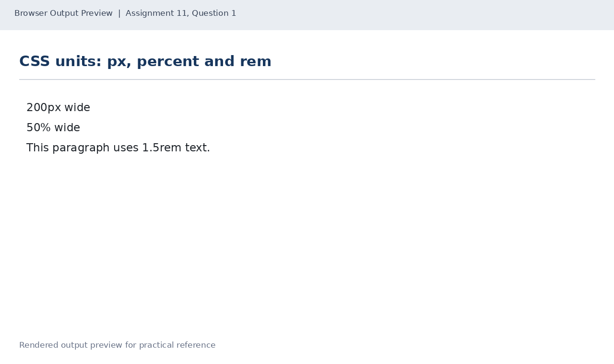
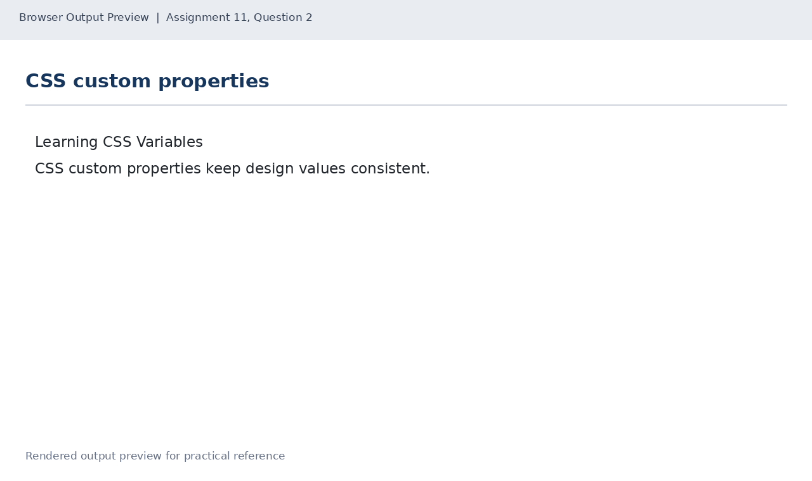
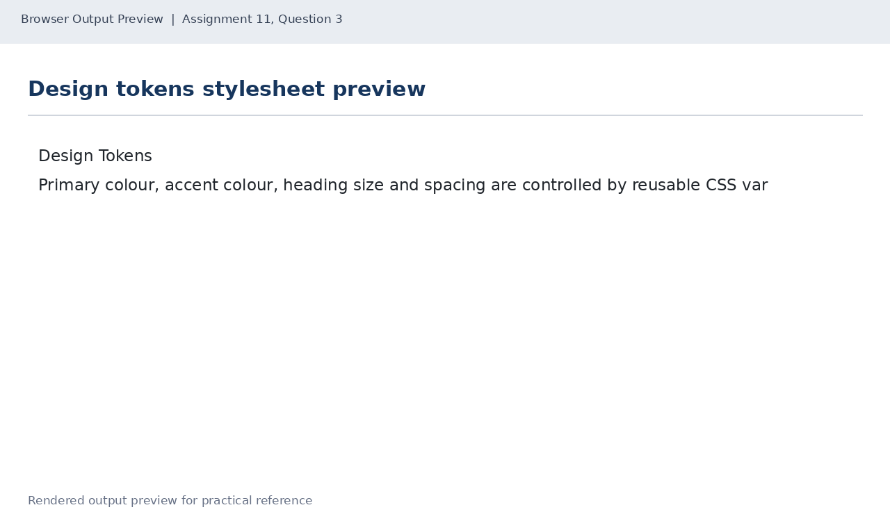

# Lab 11: Units and CSS Variables

## 📌 Objective
Mastering CSS units (px, percent %, rem) and declaring reusable design tokens using CSS Custom Properties (:root variables and var()).

---

## 📝 Lab Questions &amp; Solutions

### Question 1
**Problem Statement:**  
Create units.html with a div box 200px wide and 40px high, a div box 50% wide and 40px high, and a paragraph of any text at font size 1.5rem. Give both boxes a background colour.

**Code / Commands:**  
```html
<!DOCTYPE html>
<html lang="en">
<head>
    <meta charset="UTF-8">
    <title>CSS Units</title>
    <style>
        .pixel-box { width: 200px; height: 40px; background: lightblue; margin-bottom: 10px; }
        .percent-box { width: 50%; height: 40px; background: lightgreen; margin-bottom: 10px; }
        p { font-size: 1.5rem; }
    </style>
</head>
<body>
    <div class="pixel-box">200px wide</div>
    <div class="percent-box">50% wide</div>
    <p>This paragraph uses 1.5rem text.</p>
</body>
</html>
```

**Explanation:**  
px represents fixed pixels; % represents dimensions relative to the containing parent; rem is proportional to the root html font-size.

**Output Preview:**  


---
### Question 2
**Problem Statement:**  
Create variables.html with an h1 and a paragraph. In :root, define --main-color as #1d3557, --accent-color as #e63946 and --page-padding as 20px. Use var() for the body colour and padding, and for the h1 colour.

**Code / Commands:**  
```html
<!DOCTYPE html>
<html lang="en">
<head>
    <meta charset="UTF-8">
    <title>CSS Variables</title>
    <style>
        :root {
            --main-color: #1d3557;
            --accent-color: #e63946;
            --page-padding: 20px;
        }
        body { color: var(--main-color); padding: var(--page-padding); }
        h1 { color: var(--accent-color); }
    </style>
</head>
<body>
    <h1>Learning CSS Variables</h1>
    <p>CSS custom properties keep design values consistent.</p>
</body>
</html>
```

**Explanation:**  
Custom properties defined in :root have global scope and are recalled using the var() function.

**Output Preview:**  


---
### Question 3
**Problem Statement:**  
Create tokens.css with variables for a primary colour (#1d3557), an accent colour (#e63946), a heading size (2rem) and a spacing value (16px). Use them for the body colour and padding, and for the h1 colour and size.

**Code / Commands:**  
```css
:root {
    --primary-color: #1d3557;
    --accent-color: #e63946;
    --heading-size: 2rem;
    --spacing: 16px;
}

body {
    color: var(--primary-color);
    padding: var(--spacing);
}

h1 {
    color: var(--accent-color);
    font-size: var(--heading-size);
}
```

**Explanation:**  
Centralizing tokens into an external file establishes maintainable, system-wide design constants.

**Output Preview:**  


---

## 🚀 How to Run
1. Open `index.html` in any modern web browser.
2. View specific exercises by opening their individual `.html` files in this directory.

---
*HTML &amp; CSS Development Lab (BCS554) • Invertis University Bareilly*  
*Student: Usman Khan (BCS2024054)*
