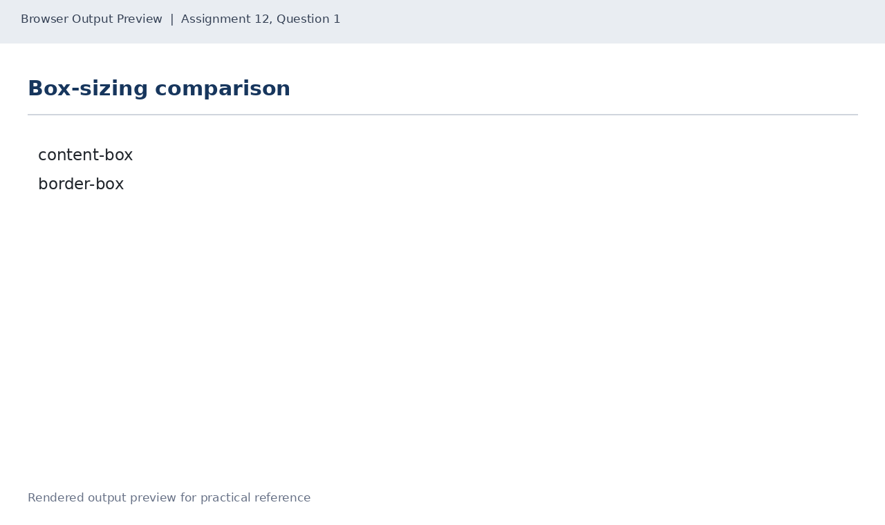
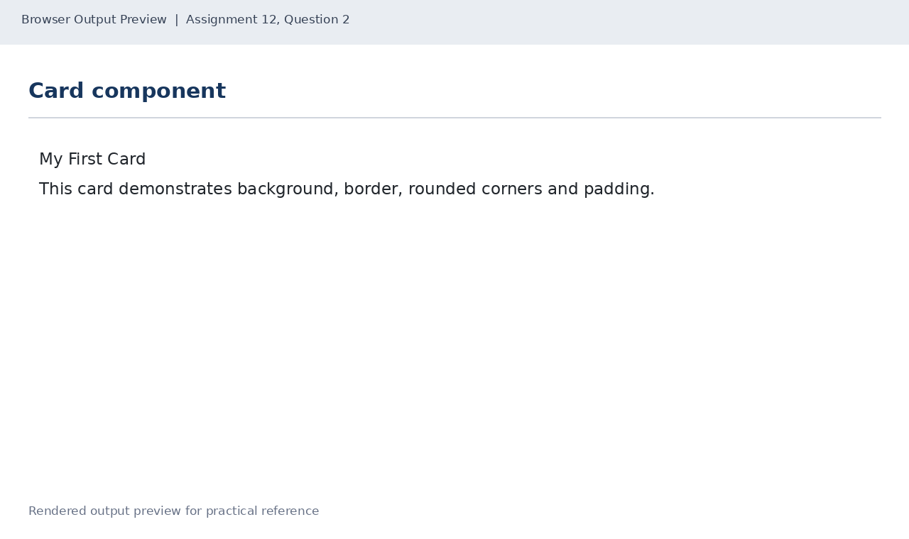
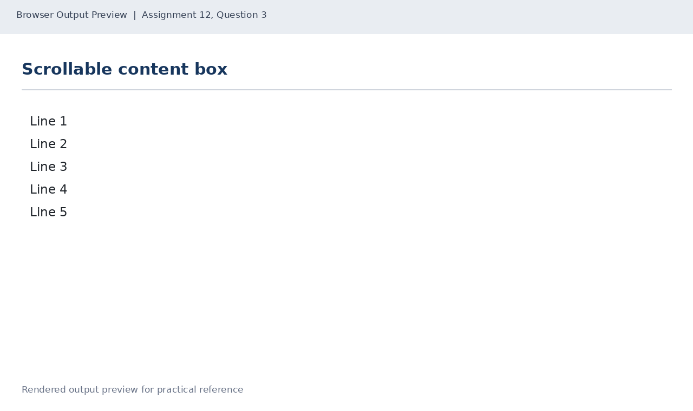

# Lab 12: Box Model, Cards and Scrolling

## 📌 Objective
Deep dive into CSS box model: content-box vs border-box sizing, designing card components with borders, radius, and padding, and scrollable containers with overflow auto.

---

## 📝 Lab Questions &amp; Solutions

### Question 1
**Problem Statement:**  
Create box-model.html with two boxes (div elements). Both have a width of 200px, padding of 20px and a border of 5px. The first uses box-sizing content-box and the second uses border-box.

**Code / Commands:**  
```html
<!DOCTYPE html>
<html lang="en">
<head>
    <meta charset="UTF-8">
    <title>Box Model</title>
    <style>
        .box { width: 200px; padding: 20px; border: 5px solid navy; margin: 10px; }
        .content-box { box-sizing: content-box; }
        .border-box { box-sizing: border-box; }
    </style>
</head>
<body>
    <div class="box content-box">Content-box sizing</div>
    <div class="box border-box">Border-box sizing</div>
</body>
</html>
```

**Explanation:**  
content-box total width = 200 + 40 (padding) + 10 (border) = 250px. border-box incorporates padding and border within the declared 200px width.

**Output Preview:**  


---
### Question 2
**Problem Statement:**  
Create card.html with one card: a div with the class card that has a background colour, a 2px border, rounded corners (border-radius 12px) and padding of 16px. Put an h3 heading and a paragraph inside it.

**Code / Commands:**  
```html
<!DOCTYPE html>
<html lang="en">
<head>
    <meta charset="UTF-8">
    <title>Card</title>
    <style>
        .card {
            background-color: #eaf2f8;
            border: 2px solid #1d3557;
            border-radius: 12px;
            padding: 16px;
            max-width: 320px;
        }
    </style>
</head>
<body>
    <div class="card">
        <h3>My First Card</h3>
        <p>This card demonstrates background, border, rounded corners and padding.</p>
    </div>
</body>
</html>
```

**Explanation:**  
border-radius rounds element corners; padding insulates content inside the border; max-width constrains horizontal expansion.

**Output Preview:**  


---
### Question 3
**Problem Statement:**  
Create scroll.html with a div box of fixed height 120px and overflow set to auto. Put five lines of text inside it as paragraphs, Line 1 to Line 5.

**Code / Commands:**  
```html
<!DOCTYPE html>
<html lang="en">
<head>
    <meta charset="UTF-8">
    <title>Scrollable Box</title>
    <style>
        .scroll-box {
            height: 120px;
            overflow: auto;
            border: 1px solid #333;
            padding: 8px;
        }
    </style>
</head>
<body>
    <div class="scroll-box">
        <p>Line 1</p><p>Line 2</p><p>Line 3</p><p>Line 4</p><p>Line 5</p>
    </div>
</body>
</html>
```

**Explanation:**  
overflow: auto introduces scrollbars only when child content overflows the fixed height boundary.

**Output Preview:**  


---

## 🚀 How to Run
1. Open `index.html` in any modern web browser.
2. View specific exercises by opening their individual `.html` files in this directory.

---
*HTML &amp; CSS Development Lab (BCS554) • Invertis University Bareilly*  
*Student: Usman Khan (BCS2024054)*
