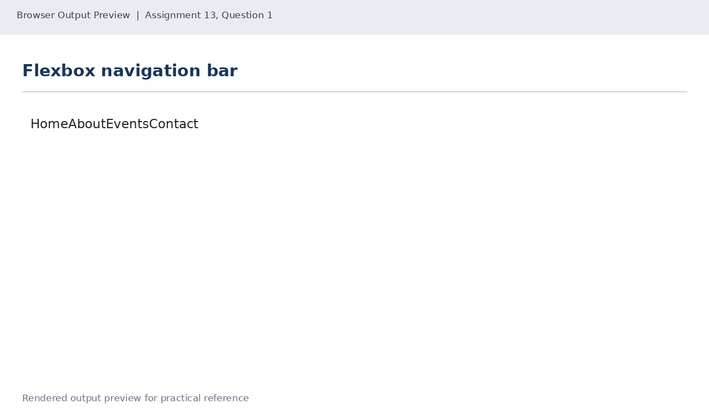
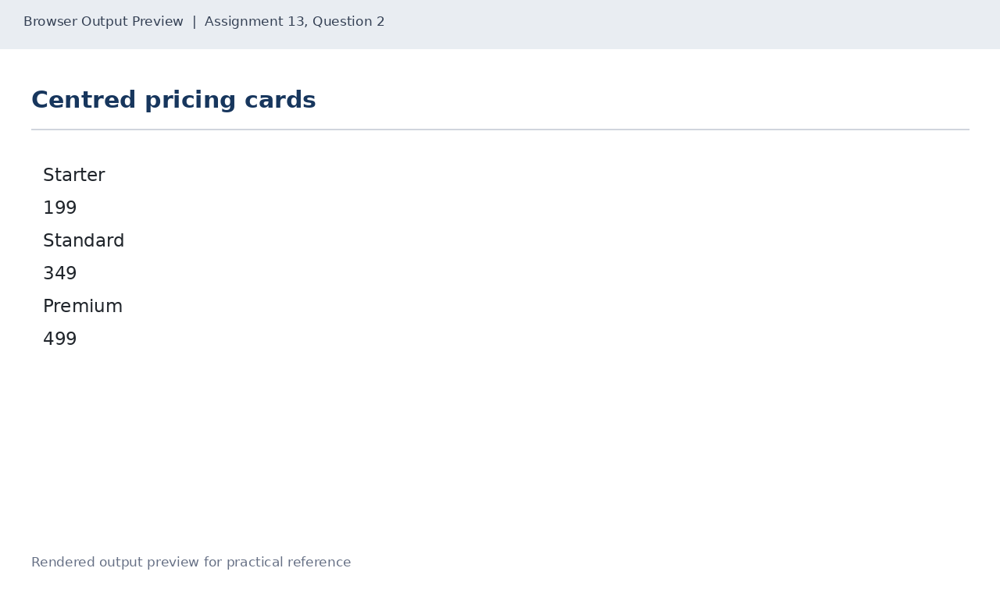
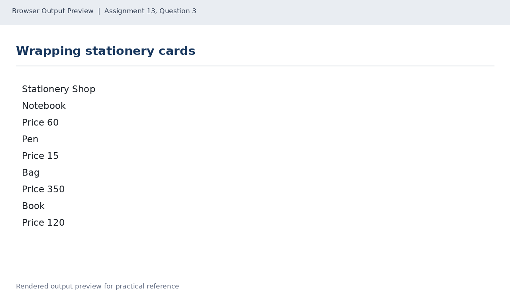

# Lab 13: Flexbox Layouts

## 📌 Objective
Flexible box layout module: horizontal navigation with display flex and gap, alignment with justify-content and align-items, and responsive cards using flex-wrap.

---

## 📝 Lab Questions &amp; Solutions

### Question 1
**Problem Statement:**  
Create nav-flex.html with a horizontal navigation bar (a nav element) of four links: Home, About, Events and Contact. Use display flex for the bar, give it a dark background and make the link text white.

**Code / Commands:**  
```html
<!DOCTYPE html>
<html lang="en">
<head>
    <meta charset="UTF-8">
    <title>Flex Navigation</title>
    <style>
        nav { display: flex; gap: 24px; background: #222; padding: 16px; }
        nav a { color: white; text-decoration: none; }
    </style>
</head>
<body>
    <nav>
        <a href="#">Home</a><a href="#">About</a>
        <a href="#">Events</a><a href="#">Contact</a>
    </nav>
</body>
</html>
```

**Explanation:**  
display: flex renders children along a horizontal row by default. gap adds spacing between items.

**Output Preview:**  


---
### Question 2
**Problem Statement:**  
Create centred-cards.html with a div (class row) holding three cards (class card) in one row. Each card has an h3 heading (Starter, Standard, Premium) and a paragraph with the price 199, 349 or 499. Use justify-content and align-items to centre the cards in the row.

**Code / Commands:**  
```html
<!DOCTYPE html>
<html lang="en">
<head>
    <meta charset="UTF-8">
    <title>Centred Cards</title>
    <style>
        .row {
            display: flex;
            justify-content: center;
            align-items: center;
            gap: 20px;
            min-height: 250px;
        }
        .card { border: 1px solid #555; padding: 20px; width: 150px; text-align: center; }
    </style>
</head>
<body>
    <div class="row">
        <div class="card"><h3>Starter</h3><p>199</p></div>
        <div class="card"><h3>Standard</h3><p>349</p></div>
        <div class="card"><h3>Premium</h3><p>499</p></div>
    </div>
</body>
</html>
```

**Explanation:**  
justify-content centers items on main axis (horizontal); align-items centers on cross axis (vertical).

**Output Preview:**  


---
### Question 3
**Problem Statement:**  
Create wrapping-cards.html with the heading Stationery Shop and four cards in a flex-wrap row: Notebook (price 60), Pen (price 15), Bag (price 350) and Book (price 120). Narrow the browser window to check the wrapping.

**Code / Commands:**  
```html
<!DOCTYPE html>
<html lang="en">
<head>
    <meta charset="UTF-8">
    <title>Stationery Shop</title>
    <style>
        .cards { display: flex; flex-wrap: wrap; gap: 16px; }
        .card { flex: 1 1 160px; border: 1px solid #777; padding: 16px; }
    </style>
</head>
<body>
    <h1>Stationery Shop</h1>
    <div class="cards">
        <div class="card"><h3>Notebook</h3><p>Price 60</p></div>
        <div class="card"><h3>Pen</h3><p>Price 15</p></div>
        <div class="card"><h3>Bag</h3><p>Price 350</p></div>
        <div class="card"><h3>Book</h3><p>Price 120</p></div>
    </div>
</body>
</html>
```

**Explanation:**  
flex-wrap: wrap permits items to wrap onto subsequent rows when container width diminishes. flex: 1 1 160px sets initial flex-basis.

**Output Preview:**  


---

## 🚀 How to Run
1. Open `index.html` in any modern web browser.
2. View specific exercises by opening their individual `.html` files in this directory.

---
*HTML &amp; CSS Development Lab (BCS554) • Invertis University Bareilly*  
*Student: Usman Khan (BCS2024054)*
