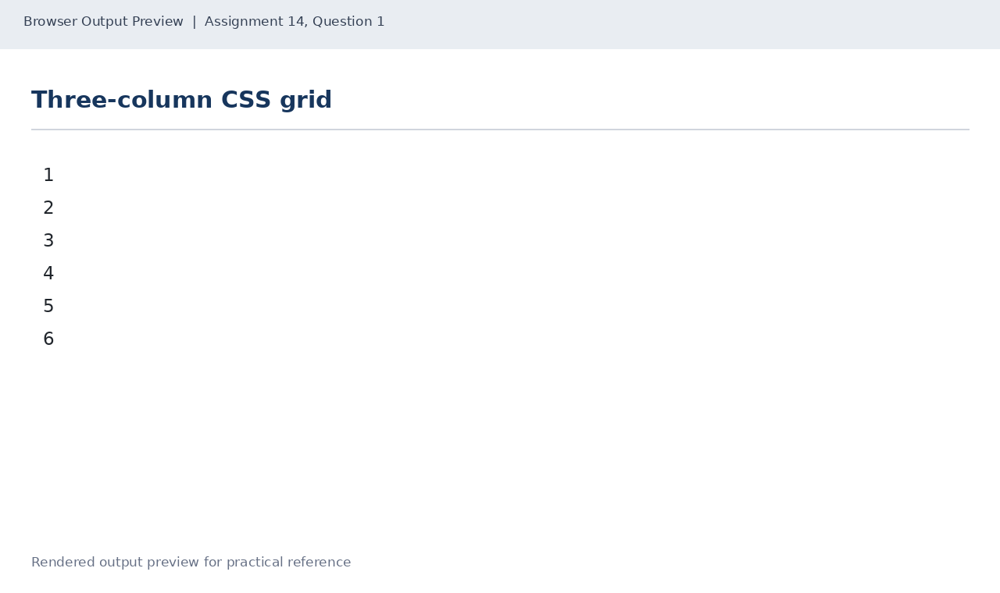
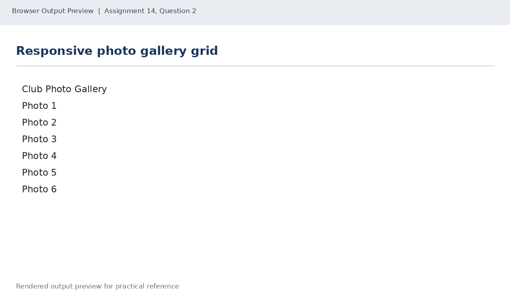
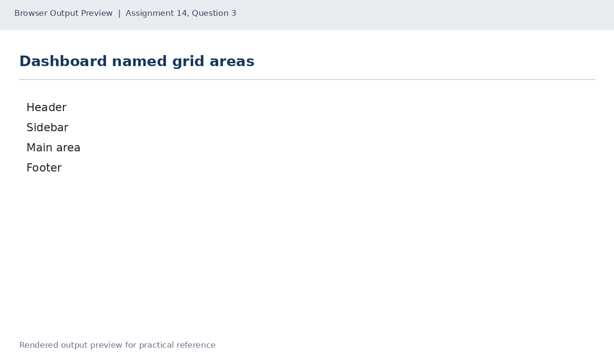

# Lab 14: CSS Grid Layouts

## 📌 Objective
Two-dimensional layout with CSS Grid: fractional units (fr), repeat(), responsive autofill galleries with minmax(), and semantic grid-template-areas.

---

## 📝 Lab Questions &amp; Solutions

### Question 1
**Problem Statement:**  
Create grid-first.html with six boxes (div elements) showing the numbers 1 to 6, in a grid of three equal columns (fr units) with a gap of 12px.

**Code / Commands:**  
```html
<!DOCTYPE html>
<html lang="en">
<head>
    <meta charset="UTF-8">
    <title>First Grid</title>
    <style>
        .grid { display: grid; grid-template-columns: repeat(3, 1fr); gap: 12px; }
        .box { padding: 24px; background: #dceaf7; text-align: center; border: 1px solid #456; }
    </style>
</head>
<body>
    <div class="grid">
        <div class="box">1</div><div class="box">2</div><div class="box">3</div>
        <div class="box">4</div><div class="box">5</div><div class="box">6</div>
    </div>
</body>
</html>
```

**Explanation:**  
repeat(3, 1fr) creates three equal columns; fr divides available container width evenly.

**Output Preview:**  


---
### Question 2
**Problem Statement:**  
Create gallery.html with an h1 heading Club Photo Gallery and six boxes labelled Photo 1 to Photo 6. Use grid-template-columns with repeat(auto-fill, minmax(150px, 1fr)) and a gap of 10px.

**Code / Commands:**  
```html
<!DOCTYPE html>
<html lang="en">
<head>
    <meta charset="UTF-8">
    <title>Club Photo Gallery</title>
    <style>
        .gallery {
            display: grid;
            grid-template-columns: repeat(auto-fill, minmax(150px, 1fr));
            gap: 10px;
        }
        .photo {
            min-height: 120px;
            display: grid;
            place-items: center;
            background: #e8eef5;
            border: 1px solid #789;
        }
    </style>
</head>
<body>
    <h1>Club Photo Gallery</h1>
    <div class="gallery">
        <div class="photo">Photo 1</div><div class="photo">Photo 2</div>
        <div class="photo">Photo 3</div><div class="photo">Photo 4</div>
        <div class="photo">Photo 5</div><div class="photo">Photo 6</div>
    </div>
</body>
</html>
```

**Explanation:**  
auto-fill with minmax(150px, 1fr) dynamically adapts the number of columns based on screen width without requiring media queries.

**Output Preview:**  


---
### Question 3
**Problem Statement:**  
Create dashboard-areas.html with a grid of two columns, 200px and 1fr. Use grid-template-areas to place a header and a footer across both columns, a sidebar on the left and a main area on the right.

**Code / Commands:**  
```html
<!DOCTYPE html>
<html lang="en">
<head>
    <meta charset="UTF-8">
    <title>Dashboard Areas</title>
    <style>
        .dashboard {
            display: grid;
            grid-template-columns: 200px 1fr;
            grid-template-areas:
                "header header"
                "sidebar main"
                "footer footer";
            gap: 10px;
        }
        .header { grid-area: header; }
        .sidebar { grid-area: sidebar; }
        .main { grid-area: main; }
        .footer { grid-area: footer; }
        .dashboard > div { padding: 20px; background: #e8eef5; border: 1px solid #789; }
    </style>
</head>
<body>
    <div class="dashboard">
        <div class="header">Header</div>
        <div class="sidebar">Sidebar</div>
        <div class="main">Main area</div>
        <div class="footer">Footer</div>
    </div>
</body>
</html>
```

**Explanation:**  
grid-template-areas assigns visual layout slots by name across grid rows and columns.

**Output Preview:**  


---

## 🚀 How to Run
1. Open `index.html` in any modern web browser.
2. View specific exercises by opening their individual `.html` files in this directory.

---
*HTML &amp; CSS Development Lab (BCS554) • Invertis University Bareilly*  
*Student: Usman Khan (BCS2024054)*
