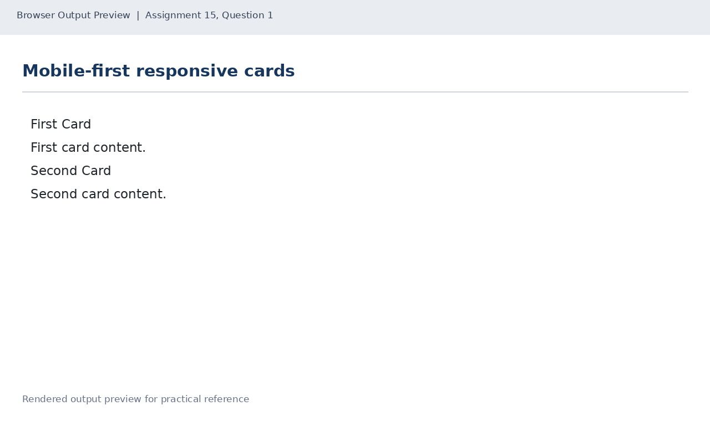
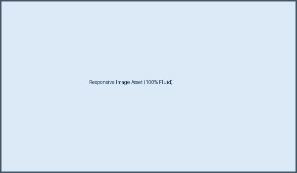
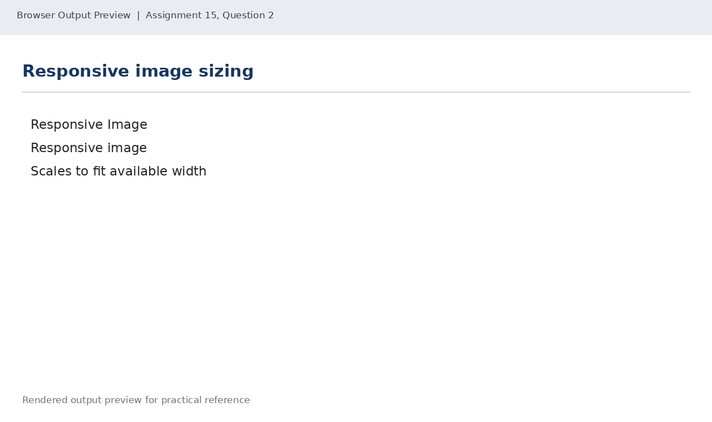
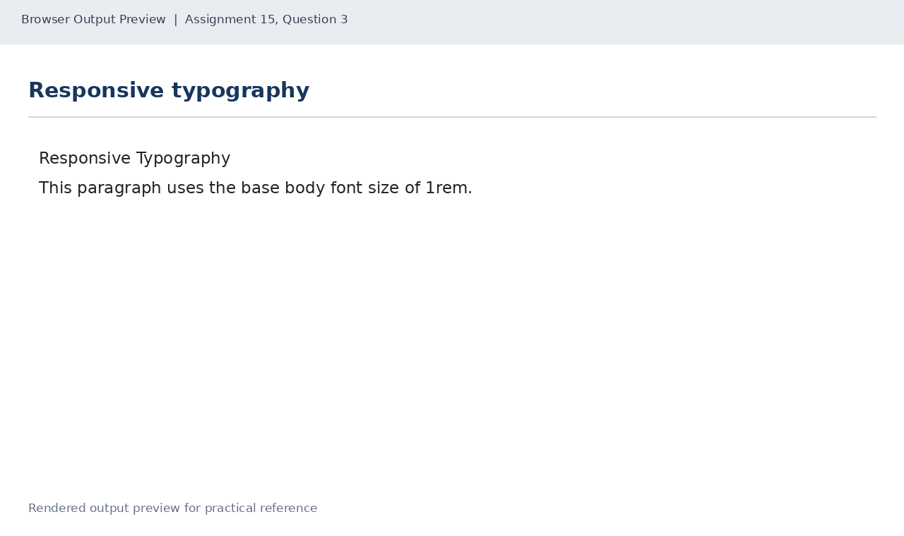

# Lab 15: Responsive Pages with Media Queries

## 📌 Objective
Mobile-first responsive design: viewport meta tag, flex-direction switching with media queries, fluid responsive images, and viewport-adaptive typography.

---

## 📝 Lab Questions &amp; Solutions

### Question 1
**Problem Statement:**  
Create mobile-first.html with the viewport meta tag in the head, and a div with the class cards holding two cards (class card), each with an h2 heading and a paragraph. Write base styles for phones, then add a media query for screens 600px wide and up that shows the cards side by side.

**Code / Commands:**  
```html
<!DOCTYPE html>
<html lang="en">
<head>
    <meta charset="UTF-8">
    <meta name="viewport" content="width=device-width, initial-scale=1.0">
    <title>Mobile First Cards</title>
    <style>
        .cards { display: flex; flex-direction: column; gap: 16px; }
        .card { padding: 18px; border: 1px solid #777; }
        @media (min-width: 600px) {
            .cards { flex-direction: row; }
            .card { flex: 1; }
        }
    </style>
</head>
<body>
    <div class="cards">
        <div class="card"><h2>First Card</h2><p>First card content.</p></div>
        <div class="card"><h2>Second Card</h2><p>Second card content.</p></div>
    </div>
</body>
</html>
```

**Explanation:**  
Mobile-first sets stacked styles for small devices as default and adds min-width: 600px media query for wider displays.

**Output Preview:**  


---
### Question 2
**Problem Statement:**  
Create responsive-image.html with a heading and one picture from the images folder. Set the picture to max-width 100% and height auto, so it shrinks to fit a narrow window. Use the file name your instructor gives you.

**Code / Commands:**  
```html
<!DOCTYPE html>
<html lang="en">
<head>
    <meta charset="UTF-8">
    <meta name="viewport" content="width=device-width, initial-scale=1.0">
    <title>Responsive Image</title>
    <style>
        img { max-width: 100%; height: auto; display: block; }
    </style>
</head>
<body>
    <h1>Responsive Image</h1>
    
</body>
</html>
```

**Explanation:**  
max-width: 100% ensures an image never exceeds its parent width; height: auto preserves the aspect ratio.

**Output Preview:**  


---
### Question 3
**Problem Statement:**  
Create responsive-text.html with an h1 heading and a paragraph. Set the body font size to 1rem and the h1 to 1.5rem. Add a media query for screens 600px wide and up that sets the h1 to 2.5rem.

**Code / Commands:**  
```html
<!DOCTYPE html>
<html lang="en">
<head>
    <meta charset="UTF-8">
    <meta name="viewport" content="width=device-width, initial-scale=1.0">
    <title>Responsive Text</title>
    <style>
        body { font-size: 1rem; }
        h1 { font-size: 1.5rem; }
        @media (min-width: 600px) {
            h1 { font-size: 2.5rem; }
        }
    </style>
</head>
<body>
    <h1>Responsive Typography</h1>
    <p>This paragraph uses the base body font size of 1rem.</p>
</body>
</html>
```

**Explanation:**  
Typography scales using media queries: h1 transitions from 1.5rem on small viewports to 2.5rem above 600px.

**Output Preview:**  


---

## 🚀 How to Run
1. Open `index.html` in any modern web browser.
2. View specific exercises by opening their individual `.html` files in this directory.

---
*HTML &amp; CSS Development Lab (BCS554) • Invertis University Bareilly*  
*Student: Usman Khan (BCS2024054)*
