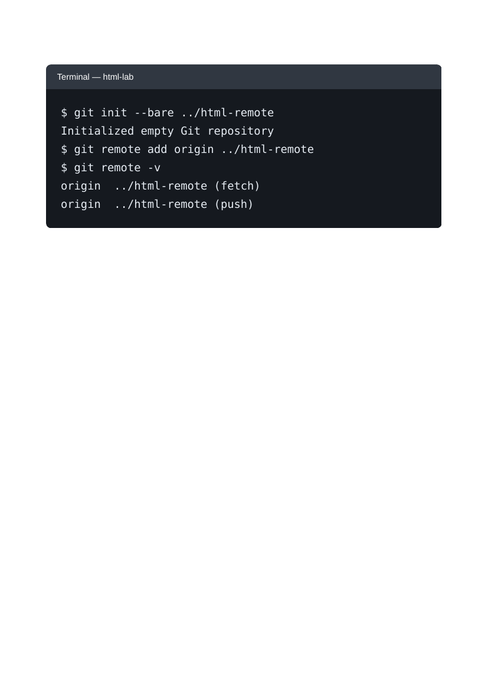
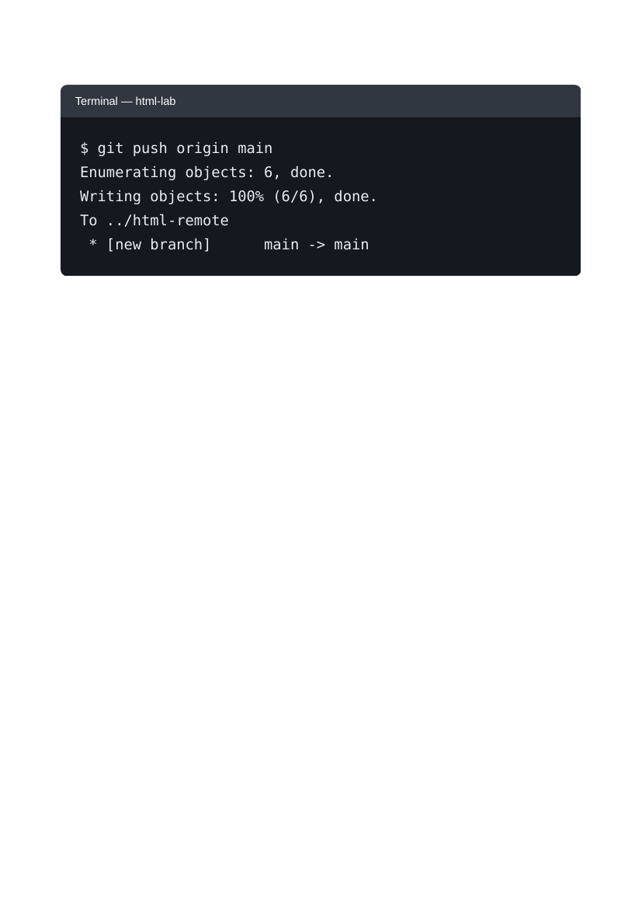
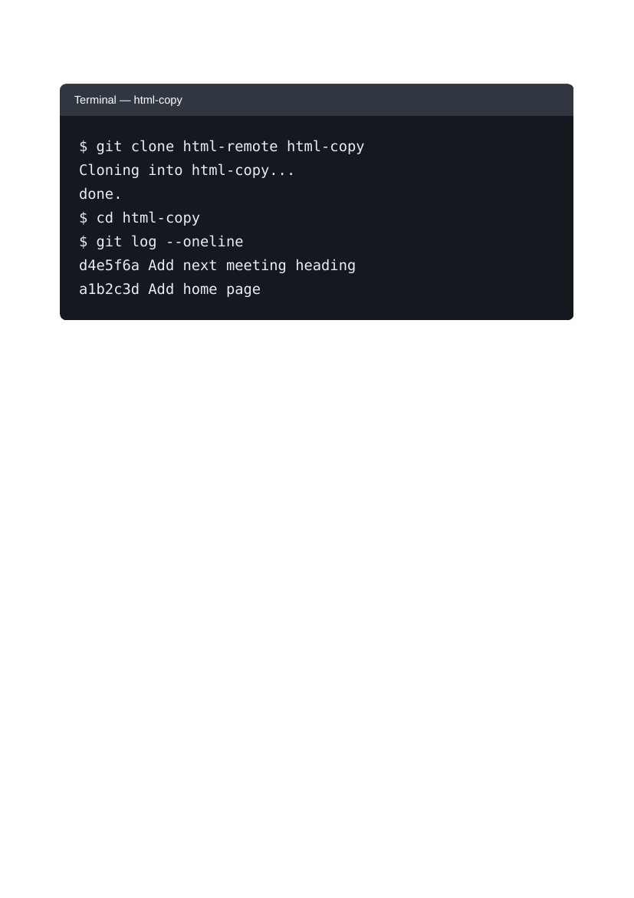

# Lab 2: Pushing and Cloning a Repository

## 📌 Objective
Understanding Git remotes: creating bare repositories, pushing commits to origin, and cloning into fresh working copies.

---

## 📝 Lab Questions &amp; Solutions

### Question 1
**Problem Statement:**  
Run git init --bare ../html-remote inside html-lab to create an empty repository next to it. Then add it as origin with git remote add origin ../html-remote, and run git remote -v.

**Code / Commands:**  
```bash
git init --bare ../html-remote
git remote add origin ../html-remote
git remote -v
```

**Explanation:**  
A bare repository has no working tree and acts as a central storage remote. git remote add origin links the bare repository as origin.

**Output Preview:**  


---
### Question 2
**Problem Statement:**  
Push your commits to origin with git push origin main. If git status shows On branch master, use git push origin master instead.

**Code / Commands:**  
```bash
git branch
git push origin main
# If your branch is named master:
git push origin master
```

**Explanation:**  
git push uploads commits from your current local branch to the remote origin.

**Output Preview:**  


---
### Question 3
**Problem Statement:**  
Go up one folder from html-lab (cd ..) and clone html-remote into a new folder named html-copy with git clone html-remote html-copy. Then go into html-copy and run git log --oneline.

**Code / Commands:**  
```bash
cd ..
git clone html-remote html-copy
cd html-copy
git log --oneline
```

**Explanation:**  
git clone creates a full clone of the remote repository with complete commit history into html-copy.

**Output Preview:**  


---

## 🚀 How to Run
1. Open `index.html` in any modern web browser.
2. View specific exercises by opening their individual `.html` files in this directory.

---
*HTML &amp; CSS Development Lab (BCS554) • Invertis University Bareilly*  
*Student: Usman Khan (BCS2024054)*
