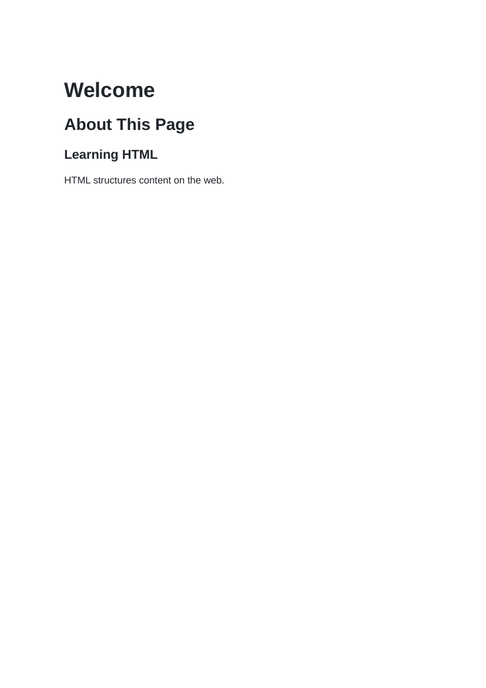
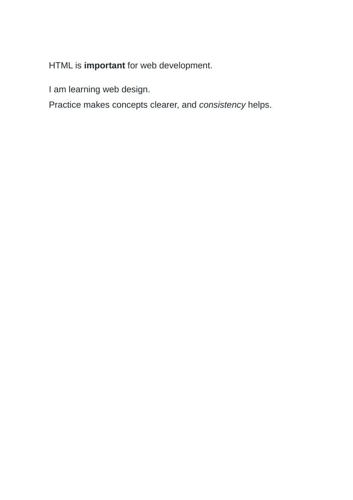

# Lab 3: Your First HTML Page

## 📌 Objective
HTML document structure, page titles, hierarchical headings (h1, h2, h3), paragraphs, line breaks, and semantic formatting with strong and em.

---

## 📝 Lab Questions &amp; Solutions

### Question 1
**Problem Statement:**  
Create first.html with the document structure, the title My First Page, and one h1 heading: Hello, I am Asha. Open it in a browser.

**Code / Commands:**  
```html
<!DOCTYPE html>
<html lang="en">
<head>
    <meta charset="UTF-8">
    <title>My First Page</title>
</head>
<body>
    <h1>Hello, I am Asha.</h1>
</body>
</html>
```

**Explanation:**  
The title element defines the title shown on the browser tab; the h1 tag defines the highest-level visible heading on the page.

**Output Preview:**  


---
### Question 2
**Problem Statement:**  
Create headings.html with an h1 heading, an h2 heading, an h3 heading and one paragraph. Write any text for them.

**Code / Commands:**  
```html
<!DOCTYPE html>
<html lang="en">
<head>
    <meta charset="UTF-8">
    <title>Headings</title>
</head>
<body>
    <h1>Welcome</h1>
    <h2>About This Page</h2>
    <h3>Learning HTML</h3>
    <p>HTML structures content on the web.</p>
</body>
</html>
```

**Explanation:**  
HTML supports six heading levels from h1 to h6. Paragraphs are wrapped in p tags.

**Output Preview:**  


---
### Question 3
**Problem Statement:**  
Create text-format.html with two paragraphs of any text. Use strong and em on one word each, and put a line break inside one paragraph.

**Code / Commands:**  
```html
<!DOCTYPE html>
<html lang="en">
<head>
    <meta charset="UTF-8">
    <title>Text Formatting</title>
</head>
<body>
    <p>HTML is <strong>important</strong> for web development.</p>
    <p>I am learning web design.<br>Practice makes concepts clearer, and <em>consistency</em> helps.</p>
</body>
</html>
```

**Explanation:**  
strong gives strong importance (rendered bold), em adds stress emphasis (rendered italic), and br inserts a line break.

**Output Preview:**  


---

## 🚀 How to Run
1. Open `index.html` in any modern web browser.
2. View specific exercises by opening their individual `.html` files in this directory.

---
*HTML &amp; CSS Development Lab (BCS554) • Invertis University Bareilly*  
*Student: Usman Khan (BCS2024054)*
