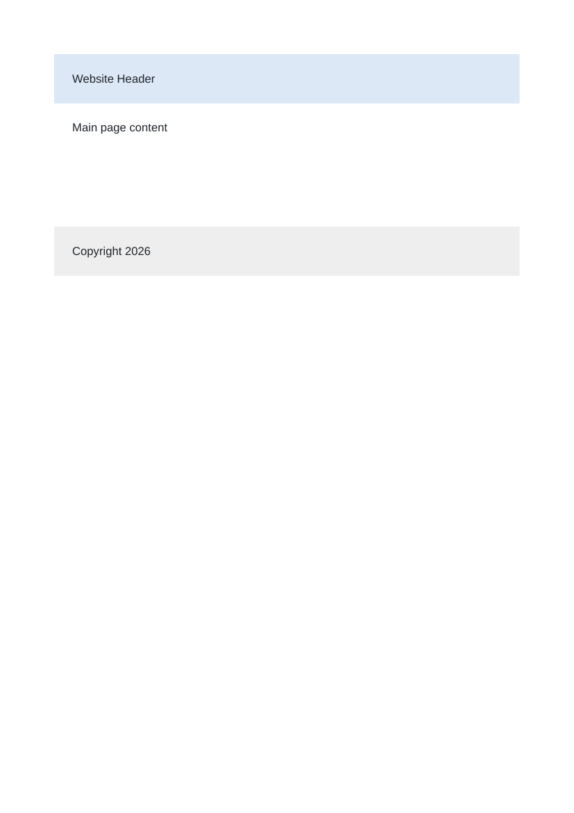

# Lab 4: Divs, Attributes and a Small Fix

## 📌 Objective
Grouping content with div containers, applying CSS classes and ID attributes, adding custom HTML5 data attributes, and debugging malformed HTML syntax.

---

## 📝 Lab Questions &amp; Solutions

### Question 1
**Problem Statement:**  
Create layout.html with three div blocks: one with the class header, one with the class main and one with the class footer. Put some text in each.

**Code / Commands:**  
```html
<!DOCTYPE html>
<html lang="en">
<head>
    <meta charset="UTF-8">
    <title>Layout</title>
</head>
<body>
    <div class="header">Website Header</div>
    <div class="main">Main page content</div>
    <div class="footer">Copyright 2026</div>
</body>
</html>
```

**Explanation:**  
div groups content into logical blocks. class provides a reusable selector for CSS styling.

**Output Preview:**  


---
### Question 2
**Problem Statement:**  
Create attributes.html. Give one div the id profile. Inside it, add a paragraph with the attribute data-topic set to hobbies. Write any text in the paragraph.

**Code / Commands:**  
```html
<!DOCTYPE html>
<html lang="en">
<head>
    <meta charset="UTF-8">
    <title>Profile</title>
</head>
<body>
    <div id="profile">
        <p data-topic="hobbies">My hobbies are reading, coding and cricket.</p>
    </div>
</body>
</html>
```

**Explanation:**  
The id attribute provides a unique identifier. data-topic is a custom data attribute storing metadata accessible to scripts or CSS.

**Output Preview:**  


---
### Question 3
**Problem Statement:**  
Find and fix every error in the broken page below, then save it as attendance-fixed.html: Attendance Attendance Report Asha: 92% Rohan: 85%

**Code / Commands:**  
```html
<!DOCTYPE html>
<html lang="en">
<head>
    <meta charset="UTF-8">
    <title>Attendance</title>
</head>
<body>
    <h1>Attendance Report</h1>
    <p>Asha: 92%</p>
    <p>Rohan: 85%</p>
</body>
</html>
```

**Explanation:**  
The broken markup was missing properly closed tags for h1 and p. In attendance-fixed.html, all tags are properly paired and valid HTML5 syntax is enforced.

**Output Preview:**  


---

## 🚀 How to Run
1. Open `index.html` in any modern web browser.
2. View specific exercises by opening their individual `.html` files in this directory.

---
*HTML &amp; CSS Development Lab (BCS554) • Invertis University Bareilly*  
*Student: Usman Khan (BCS2024054)*
