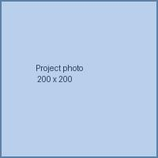
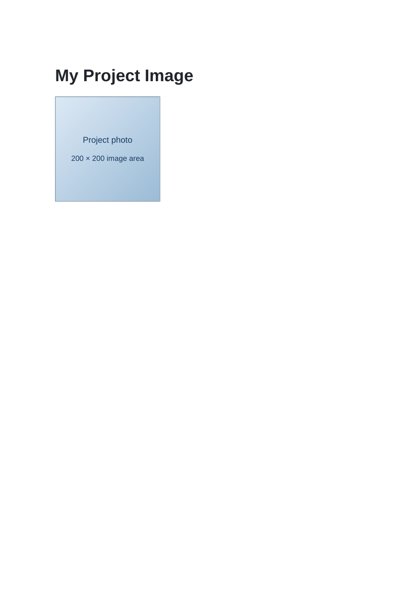

# Lab 5: Links and Images

## 📌 Objective
Hyperlinks using anchor tags with relative URLs and mailto protocols, embedding images with proper dimensions and accessibility alt attributes.

---

## 📝 Lab Questions &amp; Solutions

### Question 1
**Problem Statement:**  
Create home.html with the heading Welcome to My Site and a paragraph with a link to portfolio.html. The link text is portfolio.

**Code / Commands:**  
```html
<!DOCTYPE html>
<html lang="en">
<head>
    <meta charset="UTF-8">
    <title>Home</title>
</head>
<body>
    <h1>Welcome to My Site</h1>
    <p>View my <a href="portfolio.html">portfolio</a>.</p>
</body>
</html>
```

**Explanation:**  
The a element creates an anchor link; href specifies the target destination.

**Output Preview:**  


---
### Question 2
**Problem Statement:**  
Create portfolio.html with a heading and a link back to home.html. Write any text for the link.

**Code / Commands:**  
```html
<!DOCTYPE html>
<html lang="en">
<head>
    <meta charset="UTF-8">
    <title>Portfolio</title>
</head>
<body>
    <h1>My Portfolio</h1>
    <p><a href="home.html">Return to Home</a></p>
</body>
</html>
```

**Explanation:**  
The relative link connects portfolio.html back to home.html within the same directory.

**Output Preview:**  


---
### Question 3
**Problem Statement:**  
Create portfolio-image.html with a heading and a picture from the images folder. Set its width and height to 200 each, and write alt text that describes it. Use the file name your instructor gives you.

**Code / Commands:**  
```html
<!DOCTYPE html>
<html lang="en">
<head>
    <meta charset="UTF-8">
    <title>Portfolio Image</title>
</head>
<body>
    <h1>My Project Image</h1>
    
</body>
</html>
```

**Explanation:**  
The img element renders images using src. Setting width and height reserves dimensions, and alt ensures accessibility.

**Output Preview:**  


---

## 🚀 How to Run
1. Open `index.html` in any modern web browser.
2. View specific exercises by opening their individual `.html` files in this directory.

---
*HTML &amp; CSS Development Lab (BCS554) • Invertis University Bareilly*  
*Student: Usman Khan (BCS2024054)*
