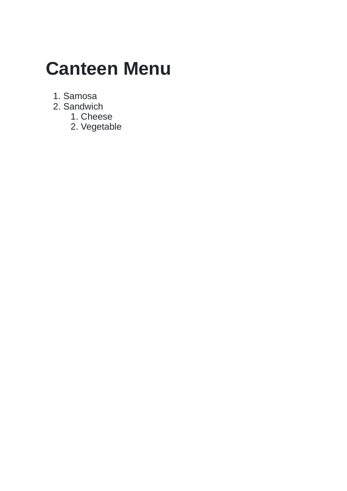
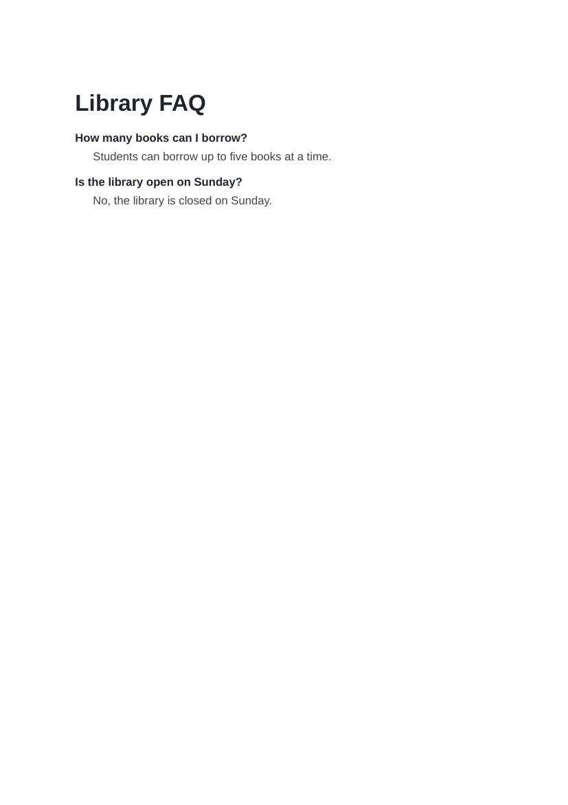

# Lab 6: Types of HTML Lists

## 📌 Objective
Creating unordered bulleted lists (ul), ordered numbered lists (ol), nested sub-lists, and description lists (dl, dt, dd).

---

## 📝 Lab Questions &amp; Solutions

### Question 1
**Problem Statement:**  
Create shopping-list.html with the heading Shopping List and an unordered list of three items: Notebook, Pen and Bag.

**Code / Commands:**  
```html
<!DOCTYPE html>
<html lang="en">
<head>
    <meta charset="UTF-8">
    <title>Shopping List</title>
</head>
<body>
    <h1>Shopping List</h1>
    <ul>
        <li>Notebook</li>
        <li>Pen</li>
        <li>Bag</li>
    </ul>
</body>
</html>
```

**Explanation:**  
ul creates a bulleted list where each item is marked with li.

**Output Preview:**  


---
### Question 2
**Problem Statement:**  
Create canteen-menu.html with the heading Canteen Menu, a numbered list of two items: Samosa and Sandwich. Under Sandwich, add a nested numbered list of two items: Cheese and Vegetable.

**Code / Commands:**  
```html
<!DOCTYPE html>
<html lang="en">
<head>
    <meta charset="UTF-8">
    <title>Canteen Menu</title>
</head>
<body>
    <h1>Canteen Menu</h1>
    <ol>
        <li>Samosa</li>
        <li>Sandwich
            <ol>
                <li>Cheese</li>
                <li>Vegetable</li>
            </ol>
        </li>
    </ol>
</body>
</html>
```

**Explanation:**  
ol creates an ordered numbered list. Nesting an inner ol within an li represents hierarchical sub-categories.

**Output Preview:**  


---
### Question 3
**Problem Statement:**  
Create faq.html with a description list of two questions: How many books can I borrow? and Is the library open on Sunday? Put each question in a dt element and write an answer in a dd element.

**Code / Commands:**  
```html
<!DOCTYPE html>
<html lang="en">
<head>
    <meta charset="UTF-8">
    <title>Library FAQ</title>
</head>
<body>
    <h1>Library FAQ</h1>
    <dl>
        <dt>How many books can I borrow?</dt>
        <dd>Students can borrow up to five books at a time.</dd>
        <dt>Is the library open on Sunday?</dt>
        <dd>No, the library is closed on Sunday.</dd>
    </dl>
</body>
</html>
```

**Explanation:**  
dl creates a description list; dt indicates terms/questions, and dd provides the corresponding definition/answer.

**Output Preview:**  


---

## 🚀 How to Run
1. Open `index.html` in any modern web browser.
2. View specific exercises by opening their individual `.html` files in this directory.

---
*HTML &amp; CSS Development Lab (BCS554) • Invertis University Bareilly*  
*Student: Usman Khan (BCS2024054)*
