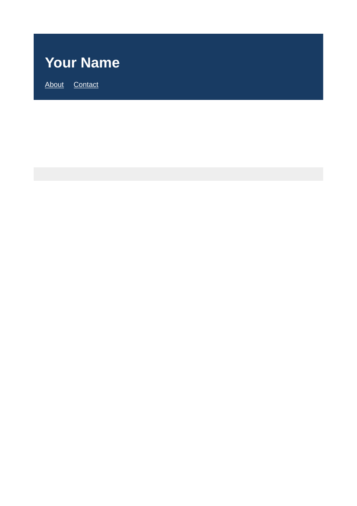
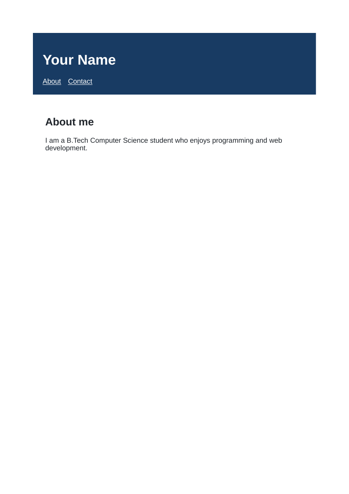
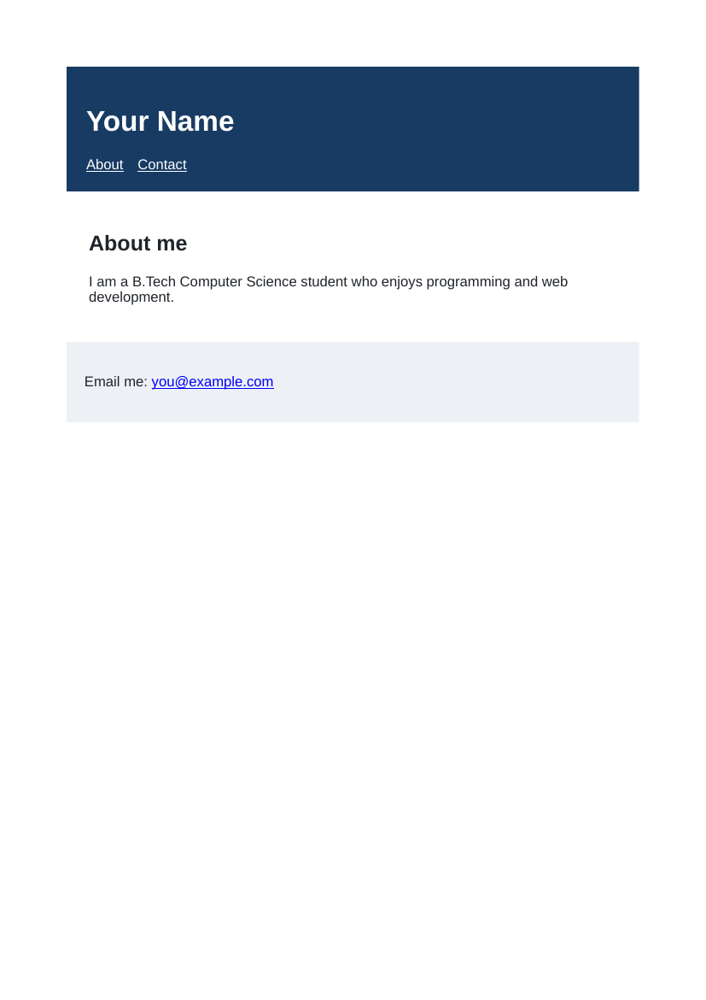

# Lab 7: About Me Page

## 📌 Objective
Building a complete personal webpage using semantic HTML5 elements (header, nav, main, section, footer), in-page anchor navigation (#about, #contact), and mailto links.

---

## 📝 Lab Questions &amp; Solutions

### Question 1
**Problem Statement:**  
Create about-me.html with a header (an h1 with your name, and a nav with two links: About to #about and Contact to #contact), an empty main and an empty footer.

**Code / Commands:**  
```html
<!DOCTYPE html>
<html lang="en">
<head>
    <meta charset="UTF-8">
    <title>About Me</title>
</head>
<body>
    <header>
        <h1>Usman Khan</h1>
        <nav><a href="#about">About</a> <a href="#contact">Contact</a></nav>
    </header>
    <main></main>
    <footer></footer>
</body>
</html>
```

**Explanation:**  
header groups primary identification and navigation; nav wraps site links targeting IDs with fragment identifiers.

**Output Preview:**  


---
### Question 2
**Problem Statement:**  
Add a section inside main with the id about. Give it an h2 heading About me and one paragraph about yourself.

**Code / Commands:**  
```html
<main>
    <section id="about">
        <h2>About me</h2>
        <p>I am a B.Tech Computer Science student who enjoys programming and web development.</p>
    </section>
</main>
```

**Explanation:**  
section represents a thematic grouping of content. id='about' binds with href='#about'.

**Output Preview:**  


---
### Question 3
**Problem Statement:**  
Add a paragraph inside the footer with a link to your email address (use mailto: in the href). Give the footer the id contact.

**Code / Commands:**  
```html
<footer id="contact">
    <p>Email me: <a href="mailto:usmankhanghazi189@gmail.com">usmankhanghazi189@gmail.com</a></p>
</footer>
```

**Explanation:**  
footer represents the footer for its nearest sectioning content. mailto: triggers default email client compose.

**Output Preview:**  


---

## 🚀 How to Run
1. Open `index.html` in any modern web browser.
2. View specific exercises by opening their individual `.html` files in this directory.

---
*HTML &amp; CSS Development Lab (BCS554) • Invertis University Bareilly*  
*Student: Usman Khan (BCS2024054)*
