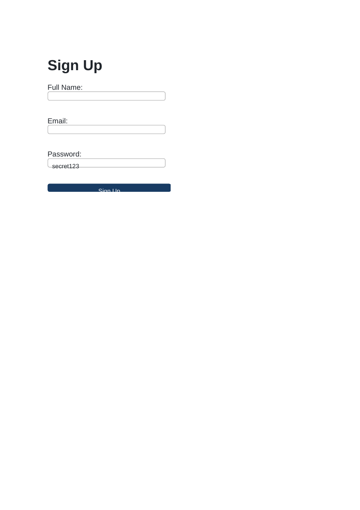
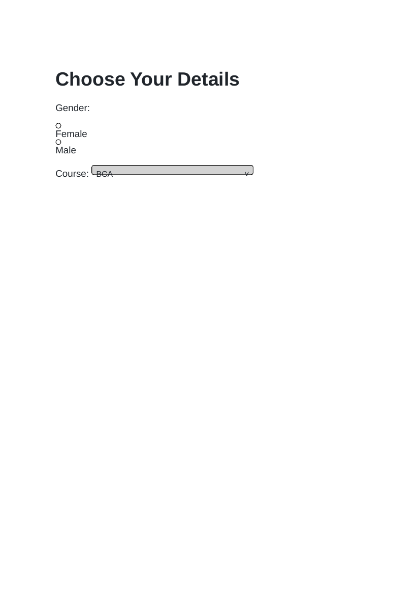

# Lab 8: Sign-Up Forms and Choices

## 📌 Objective
Constructing interactive HTML forms with post method, field labels with matching for/id, input types (text, email, password), radio buttons, select dropdowns, and HTML5 required validation.

---

## 📝 Lab Questions &amp; Solutions

### Question 1
**Problem Statement:**  
Create signup.html with a form (method post, action thanks.html; you do not need to create thanks.html). Add labelled fields for full name, email and password. Each label must be linked to its field.

**Code / Commands:**  
```html
<!DOCTYPE html>
<html lang="en">
<head>
    <meta charset="UTF-8">
    <title>Sign Up</title>
</head>
<body>
    <h1>Sign Up</h1>
    <form method="post" action="thanks.html">
        <label for="fullname">Full Name:</label>
        <input type="text" id="fullname" name="fullname"><br><br>
        <label for="email">Email:</label>
        <input type="email" id="email" name="email"><br><br>
        <label for="password">Password:</label>
        <input type="password" id="password" name="password"><br><br>
        <button type="submit">Sign Up</button>
    </form>
</body>
</html>
```

**Explanation:**  
Connecting label for attributes with input id attributes ensures screen reader accessibility and touch target focus.

**Output Preview:**  


---
### Question 2
**Problem Statement:**  
Create choices.html with a gender question using two radio buttons, Female and Male, and a course dropdown with the options BCA and B.Tech.

**Code / Commands:**  
```html
<!DOCTYPE html>
<html lang="en">
<head>
    <meta charset="UTF-8">
    <title>Choices</title>
</head>
<body>
    <h1>Choose Your Details</h1>
    <form>
        <p>Gender:</p>
        <label><input type="radio" name="gender" value="Female"> Female</label>
        <label><input type="radio" name="gender" value="Male"> Male</label>
        <p>
            <label for="course">Course:</label>
            <select id="course" name="course">
                <option value="BCA">BCA</option>
                <option value="B.Tech">B.Tech</option>
            </select>
        </p>
    </form>
</body>
</html>
```

**Explanation:**  
Radio inputs sharing the same name establish a mutually exclusive selection group. select and option build a dropdown menu.

**Output Preview:**  


---
### Question 3
**Problem Statement:**  
Create signup-required.html with a full name field and an email field. Make both required, add a placeholder to the name field, and add a Submit button.

**Code / Commands:**  
```html
<!DOCTYPE html>
<html lang="en">
<head>
    <meta charset="UTF-8">
    <title>Required Sign Up</title>
</head>
<body>
    <h1>Registration</h1>
    <form>
        <label for="name">Full Name:</label>
        <input type="text" id="name" name="name"
               placeholder="Enter your full name" required><br><br>
        <label for="email">Email:</label>
        <input type="email" id="email" name="email" required><br><br>
        <button type="submit">Submit</button>
    </form>
</body>
</html>
```

**Explanation:**  
The required attribute triggers built-in client-side browser validation before submission. The placeholder attribute provides sample formatting guidance.

**Output Preview:**  


---

## 🚀 How to Run
1. Open `index.html` in any modern web browser.
2. View specific exercises by opening their individual `.html` files in this directory.

---
*HTML &amp; CSS Development Lab (BCS554) • Invertis University Bareilly*  
*Student: Usman Khan (BCS2024054)*
