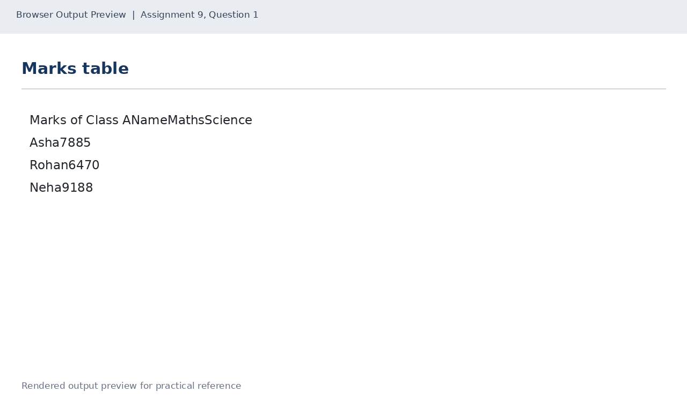
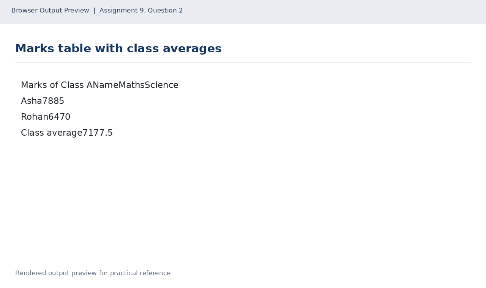
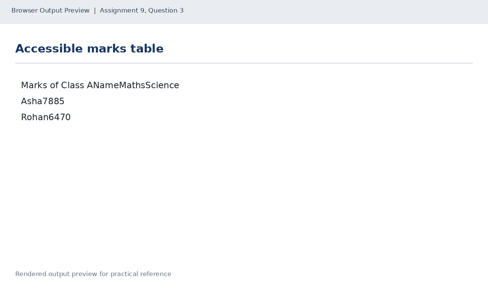

# Lab 9: Tables with Headers and Footers

## 📌 Objective
Constructing structured HTML data tables using caption, thead, tbody, tfoot, tr, th, td, and enhancing accessibility using scope attributes.

---

## 📝 Lab Questions &amp; Solutions

### Question 1
**Problem Statement:**  
Create marks.html with a table that has the caption Marks of Class A. Use thead for the header row (Name, Maths, Science) and tbody for three rows: Asha 78 85, Rohan 64 70 and Neha 91 88.

**Code / Commands:**  
```html
<!DOCTYPE html>
<html lang="en">
<head>
    <meta charset="UTF-8">
    <title>Class Marks</title>
</head>
<body>
    <table border="1">
        <caption>Marks of Class A</caption>
        <thead>
            <tr><th>Name</th><th>Maths</th><th>Science</th></tr>
        </thead>
        <tbody>
            <tr><td>Asha</td><td>78</td><td>85</td></tr>
            <tr><td>Rohan</td><td>64</td><td>70</td></tr>
            <tr><td>Neha</td><td>91</td><td>88</td></tr>
        </tbody>
    </table>
</body>
</html>
```

**Explanation:**  
caption titles the table; thead groups header cells; tbody contains the records.

**Output Preview:**  


---
### Question 2
**Problem Statement:**  
Create marks-average.html with the same caption and header as marks.html, the Asha and Rohan rows (leave out Neha), and a tfoot row called Class average with the average Maths and Science marks of the two students.

**Code / Commands:**  
```html
<!DOCTYPE html>
<html lang="en">
<head>
    <meta charset="UTF-8">
    <title>Marks Average</title>
</head>
<body>
    <table border="1">
        <caption>Marks of Class A</caption>
        <thead>
            <tr><th>Name</th><th>Maths</th><th>Science</th></tr>
        </thead>
        <tbody>
            <tr><td>Asha</td><td>78</td><td>85</td></tr>
            <tr><td>Rohan</td><td>64</td><td>70</td></tr>
        </tbody>
        <tfoot>
            <tr><th>Class average</th><td>71</td><td>77.5</td></tr>
        </tfoot>
    </table>
</body>
</html>
```

**Explanation:**  
Maths average = (78 + 64) / 2 = 71; Science average = (85 + 70) / 2 = 77.5. tfoot encloses summary rows.

**Output Preview:**  


---
### Question 3
**Problem Statement:**  
Create marks-accessible.html with the same caption, header and Asha and Rohan rows, without the footer row. Add scope='col' to each header cell and scope='row' to each name cell.

**Code / Commands:**  
```html
<!DOCTYPE html>
<html lang="en">
<head>
    <meta charset="UTF-8">
    <title>Accessible Marks</title>
</head>
<body>
    <table border="1">
        <caption>Marks of Class A</caption>
        <thead>
            <tr><th scope="col">Name</th><th scope="col">Maths</th><th scope="col">Science</th></tr>
        </thead>
        <tbody>
            <tr><th scope="row">Asha</th><td>78</td><td>85</td></tr>
            <tr><th scope="row">Rohan</th><td>64</td><td>70</td></tr>
        </tbody>
    </table>
</body>
</html>
```

**Explanation:**  
scope='col' identifies column header cells, and scope='row' identifies row header cells for screen readers.

**Output Preview:**  


---

## 🚀 How to Run
1. Open `index.html` in any modern web browser.
2. View specific exercises by opening their individual `.html` files in this directory.

---
*HTML &amp; CSS Development Lab (BCS554) • Invertis University Bareilly*  
*Student: Usman Khan (BCS2024054)*
